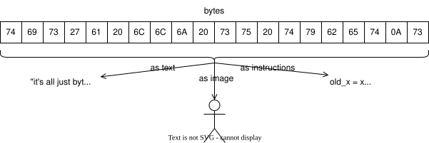
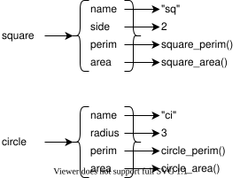
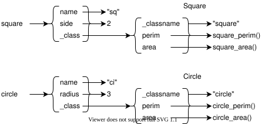
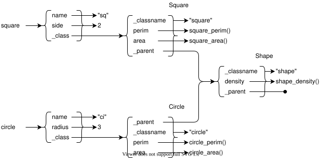
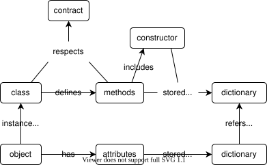

# Objects and Classes {#sec-oop}

::: {.syllabus}
- Objects are useful without classes, but classes make them easier to understand.
- A well-designed class defines a contract that code using its instances can rely on.
- Objects that respect the same contract are polymorphic, i.e., they can be used interchangeably even if they do different specific things.
- Objects and classes can be thought of as dictionaries with stereotyped behavior.
- Most languages allow functions and methods to take a variable number of arguments.
- Inheritance can be implemented in several ways that differ in the order in which objects and classes are searched for methods.
:::

We are going to create a lot of  and  in these lessons,
and they will be a lot easier to use if we understand how they are implemented.
Historically,
 (OOP) was invented to solve two problems:

1.  What is a natural way to represent real-world "things" in code?

2.  How can we organize code to make it easier to understand, test, and extend?

## Objects {#oop-objects}

As a motivating problem,
let's define some of the things a generic shape in a drawing package must be able to do:



A specification like this is sometimes called
a 
because an object must satisfy it in order to be considered a shape,
i.e.,
must provide methods with these names that do what those names suggest.
For example,
we can  classes from `Shape`
to represent squares and circles.



Since squares and circles have the same methods,
we can use them interchangeably.
This is called ,
and it reduces 
by allowing the people using related things to ignore their differences:





But how does polymorphism work?
The first thing we need to understand is that a function is an .
While the bytes in a string represent characters
and the bytes in an image represent pixels,
the bytes in a function are instructions
(@fig-oop-func-obj).
When Python executes the code below,
it creates an object in memory
that contains the instructions to print a string
and assigns that object to the variable `example`:



{#fig-oop-func-obj}

We can create an  for the function
by assigning it to another variable
and then call the function by referencing that second variable.
Doing this doesn't alter or erase
the connection between the function and the original name:





We can also store function objects in data structures like
lists and .
Let's write some functions that do
the same things as the  in our original Python
and store them in a dictionary to represent a square (@fig-oop-shapes-dict):



{#fig-oop-shapes-dict}

If we want to use one of the "methods" in this dictionary,
we call it like this:



The function `call` looks up the function stored in the dictionary,
then calls that function with the dictionary as its first object;
in other words,
instead of using `obj.meth(arg)` we use `obj["meth"](obj, arg)`.
Behind the scenes,
this is (almost) how objects actually work.
We can think of an object as a special kind of dictionary.
A method is just a function that takes an object of the right kind
as its first 
(typically called `self` in Python).

## Classes {#oop-classes}

One problem with implementing objects as dictionaries is that
it allows every single object to behave slightly differently.
In practice,
we want objects to store different values
(e.g., different squares to have different sizes)
but the same behaviors
(e.g., all squares should have the same methods).
We can implement this by storing the methods in a dictionary called `Square`
that corresponds to a class
and having each individual square contain a reference to that higher-level dictionary
(@fig-oop-shapes-class).
In the code below,
that special reference uses the key `"_class"`:



{#fig-oop-shapes-class}

Calling a method now involves one more lookup
because we have to go from the object to the class to the method,
but once again we call the "method" with the object as the first argument:



As a bonus,
we can now reliably identify objects' classes
and ask whether two objects are of the same class or not
by checking what their `"_class"` keys refer to.

### Arguments vs. Parameters

Many programmers use the words 
and  interchangeably,
but to make our meaning clear,
we call the values passed into a function its arguments
and the names the function uses to refer to them as its parameters.
Put another way,
parameters are part of the definition,
and arguments are given when the function is called.

## Arguments {#oop-args}

The methods we have defined so far operate on
the values stored in the object's dictionary,
but none of them take any extra arguments as input.
Implementing this is a little bit tricky
because different methods might need different numbers of arguments.
We could define functions `call_0`, `call_1`, `call_2` and so on
to handle each case,
but like most modern languages,
Python gives us a better way.
If we define a parameter in a function with a leading `*`,
it captures any "extra" values passed to the function
that don't line up with named parameters.
Similarly,
if we define a parameter with two leading stars `**`,
it captures any extra named parameters:





This mechanism is sometimes referred to as 
(short for "variable arguments").
A complementary mechanism called 
allows us to take a list or dictionary full of arguments
and spread them out in a call to match a function's parameters:





With these tools in hand,
let's add a method to our `Square` class
to tell us whether a square is larger than a user-specified size:



The function that implements this check for circles
looks exactly the same:



We then modify `call` to capture extra arguments in `*args`
and spread them into the function being called:



Our tests show that this works:





However,
we now have two functions that do exactly the same thing—the
only difference between them is their names.
Anything in a program that is duplicated in several places
will eventually be wrong in at least one,
so we need to find some way to share this code.

## Inheritance {#oop-inheritance}

The tool we want is .
To see how this works in Python,
let's add a method called `density` to our original `Shape` class
that uses other methods defined by the class







To enable our dictionary-based "classes" to do the same thing,
we create a dictionary to represent a generic shape
and give it a "method" to calculate density:



We then add another specially-named field to
the dictionaries for "classes" like `Square`
to keep track of their parents:



and modify the `call` function to search for
the requested method (@fig-oop-inherit-class):



{#fig-oop-inherit-class}

A simple test shows that this is working as intended:





We do have one task left, though:
we need to make sure that when a square or circle is made,
it is made correctly.
In short, we need to implement .
We do this by giving the dictionaries that implement classes
a special key `_new`
whose value is the function that builds something of that type:



In order to make an object,
we call the function associated with its `_new` key:



That function is responsible for 
the constructor of its parent.
For example,
the constructor for a square calls the constructor for a generic shape
and adds square-specific values using `|` to combine two dictionaries:



Of course,
we're not done until we test it:





## Summary {#oop-summary}

We have only scratched the surface of Python's object system.
,
,
,
and 
are powerful tools,
but they can all be understood in terms of dictionaries
that contain references to properties, functions, and other dictionaries
(@fig-oop-concept-map).

{#fig-oop-concept-map}

<section class="exercises" markdown="1">
## Exercises {#oop-exercises}

### Handling Named Arguments 

The final version of `call` declares a parameter called `*args`
to capture all the positional arguments of the method being called
and then spreads them in the actual call.
Modify it to capture and spread named arguments as well.

### Multiple Inheritance 

Implement multiple inheritance using dictionaries.
Does your implementation look methods up in the same order as Python would?

### Class Methods and Static Methods 

1.  Explain the differences between class methods and static methods.

2.  Implement both using dictionaries.

### Reporting Type 

Python `type` method reports the most specific type of an object,
while `isinstance` determines whether an object inherits from a type
either directly or indirectly.
Add your own versions of both to dictionary-based objects and classes.

### Using Recursion 

A 
is one that calls itself,
either directly or indirectly.
Modify the `find` function that finds a method to call
so that it uses recursion instead of a loop.
Which version is easier to understand?
Which version is more efficient?

### Method Caching 

Our implementation searches for the implementation of a method
every time that method is called.
An alternative is to add a  to each object
to save the methods that have been looked up before.
For example,
each object could have a special key called `_cache` whose value is a dictionary.
The keys in that dictionary are the names of methods that have been called in the past,
and the values are the functions that were found to implement those methods.
Add this feature to our dictionary-based objects.
How much more complex does it make the code?
How much extra storage space does it need compared to repeated lookup?

</section>
